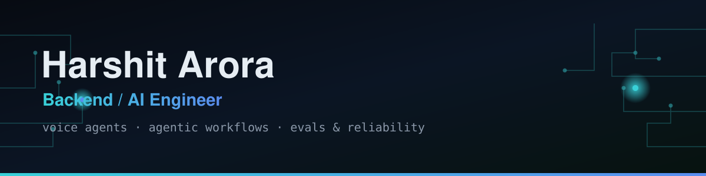

  

<h1 align="center">Harshit Arora</h1>

<b>Backend / AI Engineer · Voice Agents · Agentic Workflows · Evals & Reliability</b>

---

Six years in backend engineering (ex-Barclays). I've shipped a production voice-AI agent and an
agentic incident-triage workflow that cut failure-investigation time 50–60%, and cut API latency
25% on high-traffic systems.

**Focus** &nbsp;·&nbsp; voice agents · agentic workflows · RAG · evals & observability  
**Stack** &nbsp;·&nbsp; Java · Spring Boot · Python · Node.js · Go · AWS · GCP · MongoDB · SpannerDB · Redis · Vapi  
**Open to** &nbsp;·&nbsp; early-stage SWE roles — NYC / SF

## What I'm Building

| Project | The Question I Was Answering | Result |
|---|---|---|
| **[Incident-Triage Agent](https://github.com/hharshitarora/incident-triage-agent)** | Can an agent triage a prod incident the way I did by hand — logs → git history → issues → root cause? | ✅ v0 live · traces a crash to the culprit commit at 90% confidence · CI green |
| **[Grounded Voice Agent](https://github.com/hharshitarora/grounded-voice-agent)** | Can a voice agent answer only from grounded knowledge — and know when it can't? | ✅ v0 live · transfers instead of guessing · hallucination rate measured, not claimed |
| **[LLM Eval Gate](https://github.com/hharshitarora/llm-eval-gate)** | How do you gate quality on a non-deterministic system in CI? | ✅ v0 live · blocks a merge on real regressions, not run-to-run noise · CI green |
| **[Reply Like a Boss](https://reply-like-a-boss.vercel.app)** | Can one click make workplace writing more confident, at edge latency? | ✅ Shipped · Chrome extension + Vercel edge API |

  
  

